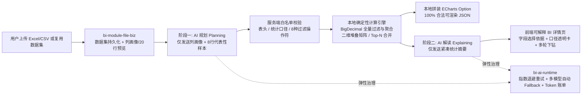
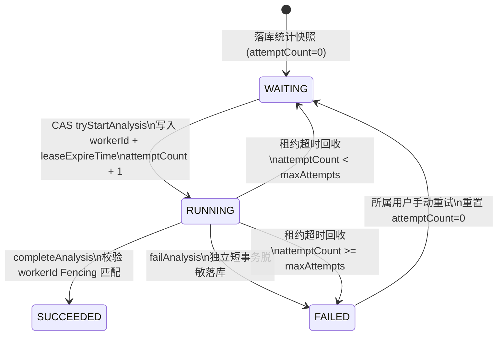

# Epiph-BI V2.0 · 可解释 AI 全栈智能分析平台

> Copyright © 2026 Epiphany119. 本项目基于上游模板进行深度架构重构与二次开发；上游作者与来源声明保留在对应模块中。

**Epiph-BI** 是一个基于 **React 18 + Ant Design Pro + Spring Boot 多模块 + MySQL + Redis + RabbitMQ + 大模型运行时** 构建的可解释智能 BI 分析平台。项目针对传统“直接把表格喂给 LLM 生成 ECharts”存在的**算术幻觉、大表 Token 爆炸、JSON 渲染崩溃、异步任务僵死及黑盒不可解释**五大痛点，构建了完整的 AI 全栈工程闭环。

## 核心架构：Plan-Compute-Explain 两阶段防幻觉引擎



## 异步任务高可用状态机（CAS + 租约 Fencing）



## 核心工程亮点

1. **Plan-Compute-Explain 防幻觉与隐私隔离**：全量明细数据不离开本地服务端；AI 只负责语义规划（支持信息不足时返回 `NEEDS_CLARIFICATION` 反问）与摘要解读，数值聚合与 ECharts 配置 100% 由服务端 `BigDecimal` 确定性生成。
2. **分布式异步任务可靠性闭环**：所有状态迁移均走带旧状态条件的原子 SQL；为每个 `RUNNING` 执行生成独立 `workerId` Fencing Token 与租约过期时间，定时恢复任务自动回收超时僵死任务并拦截超过 `maxAttempts` 的无限重试。
3. **AI Runtime 弹性治理与 FinOps 成本可观测**：独立 `bi-ai-runtime` 模块封装 `ResilientAiChatClient` 装饰器，区分 `retryable` 错误（429/5xx/超时触发带抖动指数退避，401/403 快速失败），主模型重试耗尽自动降级至白名单备用模型；两阶段 Token、估算费用与耗时持久化至 `ai_usage_log`，工作台实时展示观测面板。
4. **数据集复用与多轮追问下钻**：落地 `bi-module-file-biz` 数据集资产层，支持 8 种本地确定性过滤操作符（`EQUALS / NOT_EQUALS / IN / CONTAINS / GT / GTE / LT / LTE`）及 `/api/chart/followup` 多轮下钻；前端展示 AI 字段规划依据 `planReason`、过滤行数与父子血缘切换。
5. **24 场景离线对比评测套件**：内置 `BiArchitectureBenchmarkTest` 覆盖基础聚合、二维堆叠、条件过滤、脏数据、大表压缩与护栏拦截，支持一键生成 [EVAL-REPORT-V2.0.md](docs/EVAL-REPORT-V2.0.md)（500~2,000 行大表 Prompt Token 节省 ≥ 80%，数值准确率与 ECharts JSON 合法率 100%）。

## 项目结构

- `yubi-backend-master`：Spring Boot 多模块后端（JDK 17），核心模块包括 `bi-ai-runtime`、`bi-module-analysis-biz`、`bi-module-chart-biz`、`bi-module-file-biz`、`bi-module-user-biz`、`bi-infra`、`bi-common`、`bi-web`（详见 [后端架构说明](yubi-backend-master/README.md)）。
- `yubi-frontend-master`：React 18 + Umi + Ant Design Pro 前端工作台、FinOps 成本观测面板、可解释图表库与多轮下钻交互。
- `docs/`：完整架构与演进文档，包括 [模块边界-V1.0.md](docs/模块边界-V1.0.md)、[PRD-V2.0-AI全栈能力闭环与工程升级.md](docs/PRD-V2.0-AI全栈能力闭环与工程升级.md) 与 [EVAL-REPORT-V2.0.md](docs/EVAL-REPORT-V2.0.md)。

## 快速启动

### 1. 初始化数据库

依次在 MySQL 的 `yubi` 数据库中执行以下脚本：

```sql
SOURCE yubi-backend-master/sql/create_table.sql;
SOURCE yubi-backend-master/sql/upgrade_v2_phase1.sql;
SOURCE yubi-backend-master/sql/upgrade_v2_phase2.sql;
SOURCE yubi-backend-master/sql/upgrade_v2_phase3.sql;
```

### 2. 启动后端

1. 确保本地已启动 MySQL、Redis、RabbitMQ，JDK 与 Maven Runner 均选择 **JDK 17**。
2. 参考 `yubi-backend-master/modules/bi-web/src/main/resources/` 下的示例配置，通过环境变量或本地 `application-local.yml`（不入库）配置数据库凭据与智谱 `bi.ai.zhipu.api-key`（可选配置 `bi.ai.fallback-models` 开启多模型降级）。
3. 运行 `com.yupi.springbootinit.MainApplication`（默认端口 `8080`，上下文 `/api`）。

### 3. 启动前端

```bash
cd yubi-frontend-master
pnpm install
pnpm start:dev
```

前端默认访问 `http://localhost:8000`。

### 4. 运行单元测试与 24 场景架构评测

```bash
cd yubi-backend-master
# 运行全量多模块单元测试
mvn test

# 运行 24 场景离线对比评测并自动刷新 docs/EVAL-REPORT-V2.0.md
mvn -pl modules/bi-module-analysis-biz test -Dtest=BiArchitectureBenchmarkTest -DwriteEvalReport=true
```
