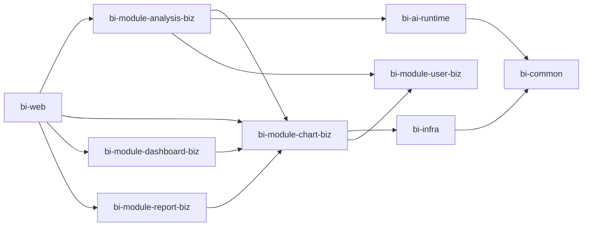

# 智能 BI 模块边界（V1.0）

本文件约定模块的职责和依赖方向。模块内可以继续按领域、应用层和基础设施适配器分层，但业务职责不能跨模块重复实现。

## 依赖方向

```text
bi-web
  └─ 业务模块（analysis / user / auth / file / chart / dashboard / report）
       ├─ bi-ai-runtime
       ├─ bi-infra
       └─ bi-common

bi-ai-runtime ──> bi-common
bi-infra      ──> bi-common
```

业务模块可以依赖运行时能力和基础设施适配器，但 `bi-ai-runtime`、`bi-infra` 不得反向依赖具体业务模块。

## 模块职责

| 模块 | 负责 | 不负责 |
|---|---|---|
| `bi-common` | 跨模块通用响应、异常、基础 DTO、通用枚举 | 具体业务流程、Spring Bean、第三方平台调用 |
| `bi-infra` | Redis、数据源、MyBatis 通用配置、COS、RabbitMQ、通用技术适配 | 具体业务实体/Mapper、AI 提示词、分析任务和用户业务规则 |
| `bi-ai-runtime` | AI 客户端、供应商配置、超时/错误处理、供应商协议响应解析 | 业务 Prompt、Excel 解析、图表结果解析、用户鉴权、任务持久化 |
| `bi-module-analysis-biz` | 分析任务、文件数据转换编排、同步/异步路由、Prompt、结果解析和重试编排；经图表应用服务保存状态和结果 | 直接拼接智谱 HTTP 请求、直接依赖 ChartMapper、实现用户登录 |
| `bi-module-user-biz` | 用户注册、登录、当前用户和用户权限 | 分析任务执行、AI 调用 |
| `bi-module-auth-biz` | 认证/授权策略和鉴权扩展 | 用户资料持久化、AI 业务逻辑 |
| `bi-module-file-biz` | 文件上传、文件元数据和文件生命周期 | 分析结论、AI 调用 |
| `bi-module-chart-biz` | Chart 实体、Chart Mapper/XML、图表 CRUD、权限、逻辑删除，以及向分析模块提供受控图表任务读写服务 | 文件转换、Prompt/AI 调用、模型结果解析和任务调度 |
| `bi-module-dashboard-biz` | 仪表盘和图表编排 | 单个图表生成 |
| `bi-module-report-biz` | 报告导出、汇总和报告模板 | AI 调用和任务调度 |
| `bi-web` | 应用启动、模块装配、Web 层公共配置 | 具体业务规则 |

## Maven 模块状态与开发顺序

| Maven 模块 | V1.0 职责 | 当前状态 |
|---|---|---|
| `bi-common` | 通用响应、异常、基础模型和工具 | 基础模块 |
| `bi-infra` | MyBatis、Redis、RabbitMQ、外部基础设施适配 | 基础模块 |
| `bi-ai-runtime` | 统一大模型调用和智谱配置 | 已完成 |
| `bi-module-user-biz` | 用户注册、登录、用户信息和用户权限 | 已有基础能力 |
| `bi-module-auth-biz` | 认证和授权扩展 | 待整理 |
| `bi-module-analysis-biz` | 文件分析任务、Prompt、AI 调用、结果解析和任务调度 | V1.0 MVP 已完成 |
| `bi-module-chart-biz` | 图表实体、图表持久化、图表 CRUD 和图表状态结果管理 | V1.0 MVP 实施中 |
| `bi-module-file-biz` | 文件元数据、文件存储和文件生命周期 | 后续模块 |
| `bi-module-dashboard-biz` | 多图表布局、看板配置和看板发布 | 后续模块 |
| `bi-module-report-biz` | 报表编排、导出和分享 | 后续模块 |

推荐开发顺序：

1. `bi-ai-runtime`：统一模型调用能力；
2. `bi-module-analysis-biz`：完成文件到 AI 分析结果的 MVP 闭环；
3. `bi-module-chart-biz`：拆出图表领域和 CRUD 能力；
4. `bi-module-file-biz`：形成文件资产和存储能力；
5. `bi-module-dashboard-biz`：组合多个图表形成看板；
6. `bi-module-report-biz`：形成报表、导出和分享能力。

## 推荐依赖方向



依赖原则：

- `bi-ai-runtime` 不依赖具体业务模块；
- `bi-module-chart-biz` 不依赖 `bi-module-analysis-biz`；
- `Chart`、`ChartMapper` 和 ChartMapper XML 由 `bi-module-chart-biz` 拥有；`bi-infra` 不引用 Chart 领域类型；
- `bi-module-analysis-biz` 通过 `ChartApplicationService` 创建任务并更新状态/结果，不直接访问 Mapper 或持久化实体；
- Dashboard 和 Report 只依赖 Chart Biz 获取图表能力；
- Web 层负责模块装配，不承载核心领域逻辑。

## bi-module-chart-biz V1.0 迁移决策

- `Chart` 实体迁移到 `bi-module-chart-biz`；
- `ChartMapper` 和 Mapper XML 与实体一起迁移到 `bi-module-chart-biz`，避免 `bi-infra` 依赖业务模块形成循环依赖；
- 图表 CRUD Controller 迁移到 `bi-module-chart-biz`；
- AI 分析 Controller 保留在 `bi-module-analysis-biz`；
- `analysis-biz` 通过命令/结果 DTO 调用 `ChartApplicationService`，不直接持有 Chart Mapper 或任意修改实体；
- `Chart` CRUD 专属 DTO 归 chart-biz，AI 分析请求 DTO 归 analysis-biz；
- 第一版不引入复杂 Repository 抽象；
- 保持既有 `/api/chart/**` HTTP 路径兼容；
- `chart-biz` 不依赖 `analysis-biz`、`AiChatClient` 或 AI Prompt/解析逻辑。

## `bi-ai-runtime` 的第一版边界

对上层只暴露“提交文本分析并返回模型文本”的能力。供应商 URL、API Key、默认模型、模型白名单、HTTP 库和响应格式均封装在模块内部。请求可选指定模型，但必须通过 Runtime 配置的白名单校验。

```text
analysis-biz ──> AiManager / AiChatClient
                     │
                     └─ Zhipu OpenAI-compatible API
```

模块内的响应解析只负责从供应商协议中提取模型文本和基础元数据。模型文本中的图表配置、分析结论等业务结构，由 `bi-module-analysis-biz` 负责解析。Runtime 不保存数据库、不读取登录用户、不处理上传文件。

对应分模块文档：`PRD-V1.0-bi-ai-runtime.md`。

## bi-ai-runtime 设计完成标准

- AI 客户端和供应商协议解析器位于 `bi-ai-runtime`，不再属于 `bi-infra`。
- 图表业务响应解析器位于 `bi-module-analysis-biz`。
- 分析模块只通过 AI runtime 使用 AI，不依赖供应商 HTTP 细节。
- 智谱成功响应、鉴权、限流、超时、5xx 和非法响应均有单元测试。
- 全量 Maven 测试通过，外部接口路径和配置项保持兼容。
